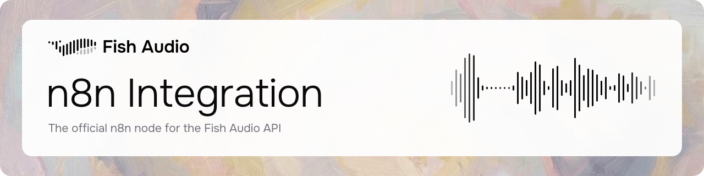

<picture>
  <source media="(prefers-color-scheme: dark)" srcset="https://raw.githubusercontent.com/fishaudio/fish-audio-n8n/refs/heads/main/.github/assets/banner-dark.svg" />
  
</picture>

# Fish Audio for n8n

The official n8n community node for [Fish Audio](https://fish.audio): text to speech, speech to text and voice cloning in your n8n workflows.

[n8n](https://n8n.io/) is a [fair-code licensed](https://docs.n8n.io/sustainable-use-license/) workflow automation platform.

> **The package is now `@fishaudio/n8n-nodes-fishaudio`.** It was previously published as `n8n-nodes-fishaudio`, which keeps working. See [Move from n8n-nodes-fishaudio](#move-from-n8n-nodes-fishaudio).

## Installation

- **Self-hosted n8n:** open **Settings → Community nodes → Install**, enter `@fishaudio/n8n-nodes-fishaudio` and confirm. For other ways to install, see n8n's [installation guide](https://docs.n8n.io/integrations/community-nodes/installation/).
- **n8n Cloud:** open the nodes panel, search for **Fish Audio** and install it from there. Cloud offers only community nodes that n8n has verified.

## Credentials

1. Create an account at [fish.audio](https://fish.audio).
2. Open [API Keys](https://fish.audio/app/api-keys) and create a key.
3. In n8n, create a **Fish Audio API** credential and paste the key. n8n checks the key when you save.

## Operations

### Speech

| Operation      | Description                                                                                                                                                                          |
| -------------- | ------------------------------------------------------------------------------------------------------------------------------------------------------------------------------------ |
| **Generate**   | Convert text to speech. Choose the model (S2.1 Pro is recommended), the voice, the output format (MP3, WAV, PCM or Opus) and options such as speed, volume, bitrate and sample rate. |
| **Transcribe** | Convert speech to text. Choose the model (Transcribe 1 Pro is recommended) and the language, and get timestamps for each segment.                                                    |

Transcribe 1 Pro marks speakers in `text` (for example `<|speaker:0|> Hello`) and, with Include Timestamps on, returns them in `speaker_turns`.

### Voice Model

| Operation  | Description                             |
| ---------- | --------------------------------------- |
| **List**   | List voice models                       |
| **Get**    | Get the details of a voice model        |
| **Create** | Create a voice model from audio samples |
| **Delete** | Delete a voice model                    |

### Account

| Operation       | Description                   |
| --------------- | ----------------------------- |
| **Get Credits** | Check your API credit balance |

The node can also be used as a tool by n8n's AI Agent.

## Workflow templates

The [`templates`](templates) folder has workflows you can import. In n8n, open a new workflow, select **⋯ → Import → From URL** (**Import from URL** in n8n 1.x) and paste the URL, or download the file and import it from a file. Then follow the setup note in the template: create the credential that protects its webhook or form (Header Auth or Basic Auth), select your Fish Audio credential in each Fish Audio node, and publish the workflow (**Active** toggle in n8n 1.x).

| Template                          | What it does                                                                       | Import URL                                                                                              |
| --------------------------------- | ---------------------------------------------------------------------------------- | ------------------------------------------------------------------------------------------------------- |
| Text to speech API                | A webhook that takes `{"text": "...", "voice_id": "..."}` and returns an MP3 file. | `https://raw.githubusercontent.com/fishaudio/fish-audio-n8n/main/templates/text-to-speech-api.json`     |
| Transcribe an uploaded audio file | A form where people upload a recording and see its transcript.                     | `https://raw.githubusercontent.com/fishaudio/fish-audio-n8n/main/templates/transcribe-audio-form.json`  |
| Re-voice a recording              | A form that transcribes a recording and returns the same words in another voice.   | `https://raw.githubusercontent.com/fishaudio/fish-audio-n8n/main/templates/revoice-recording-form.json` |

The templates need version 0.5.0 or later.

## Move from n8n-nodes-fishaudio

`@fishaudio/n8n-nodes-fishaudio` is the same node as `n8n-nodes-fishaudio`, published by Fish Audio's npm organization from this repository. New versions are published as `@fishaudio/n8n-nodes-fishaudio`.

**Nothing breaks if you wait.** Workflows that use `n8n-nodes-fishaudio` keep working. From version 0.5.0, that node shows a notice at the top of its settings.

- **Self-hosted n8n:** you can switch now.
- **n8n Cloud:** switch once `@fishaudio/n8n-nodes-fishaudio` appears in the nodes panel. Cloud installs only nodes that n8n has verified.

n8n stores the package name in each workflow, so a workflow uses the new package only after its Fish Audio nodes are replaced. Your Fish Audio credential works with both packages, so you don't need to enter the API key again.

### Replace the node in the editor

This works on any n8n, including n8n Cloud.

1. If your n8n offers it, update `n8n-nodes-fishaudio` to 0.5.0 or later first: its node then shows the notice, which tells the two Fish Audio nodes apart. Then install `@fishaudio/n8n-nodes-fishaudio`, and keep both installed until you finish.
2. Open a workflow that uses Fish Audio. If it is published and the editor shows unpublished changes, decide about those first: step 3 publishes everything in the draft. For each Fish Audio node:
   1. Add a Fish Audio node from the nodes panel and choose the same operation. While both packages are installed, the panel shows two Fish Audio nodes; the one from the previous package shows the notice when you open it.
   2. Select your Fish Audio credential and enter the same parameters as in the old node. Copy the old node's **Settings** tab too (for example Always Output Data, Execute Once, Retry On Fail and On Error), and its notes. If the old node is deactivated, deactivate the new one.
   3. Connect the new node in place of the old one, and delete the old node.
   4. Give the new node the old node's name. Expressions such as `$('Fish Audio')` refer to a node by name.
3. If the workflow is published, **publish** it again (in n8n 1.x, save it while it is active). Saving alone changes only the draft: the published workflow keeps using the old node until you publish. If the workflow is not published, just save it; publishing would turn it on.
4. Run the workflow once to check it.
5. Uninstall `n8n-nodes-fishaudio` only when no workflow uses it **and** no execution that started before your change is still queued, running or waiting (for example at a Wait node or a form). Such an execution runs with the old node. Retrying an old execution with its original workflow, or restoring an older workflow version, also needs the old package.

This guide covers only the editor. Don't use the `n8n export:workflow` and `n8n import:workflow` commands to move workflows: by default `import:workflow` unpublishes the workflows it imports, and it overwrites their saved state, such as a polling trigger's position.

## Resources

- [Fish Audio](https://fish.audio)
- [Fish Audio API documentation](https://docs.fish.audio)
- [n8n community nodes documentation](https://docs.n8n.io/integrations/community-nodes/)
- [Releasing this package](RELEASING.md)
